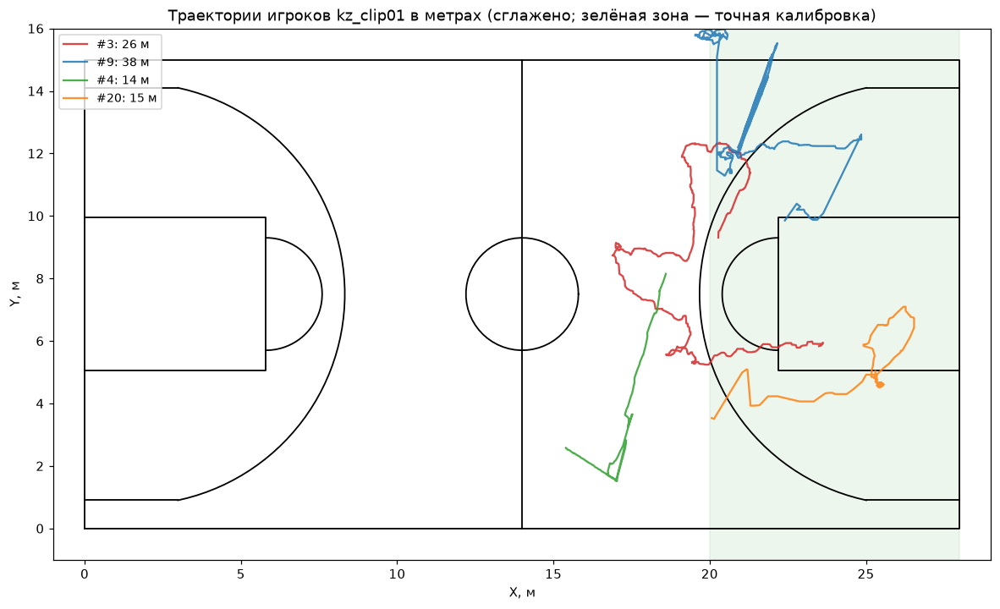

# Basketball Tracking — из трансляции на карту площадки

Рабочий офлайн-пайплайн для баскетбольных трансляций: на входе — видео, на выходе — ролик с ID и миникартой, покадровые координаты в метрах и траектории по трекам. Демо проверено на 32-секундном отрезке матча «Алматинский Легион» — «Барсы» со статичной камерой.



## Что получилось

| Результат чистого прогона на Apple Silicon (MPS) | Значение |
| --- | ---: |
| Обработано кадров | 960 (32 с при 30 кадрах/с) |
| Покадровых записей с координатами | 9 752 |
| Медиана активных треков на кадр | 10 |
| Различных ID за клип | 38 |
| Ошибка репроекции на 7 опорных точках | 0,07 м в среднем |
| Скорость детекции и трекинга, без рендера ролика | ~62 кадра/с |

После прогона в `output/`:

- `kz_demo.mp4` — трансляция с ID и положение игроков на миникарте.
- `tracks_kz_clip01_court.parquet` — номер кадра, ID трека, уверенность детекции, экранная точка и сырые/сглаженные координаты в метрах.
- `05_kz_frame_court.png` и `05_kz_trajectories.png` — кадр с проекцией и карта траекторий. Ноутбук также считает оценки дистанции и скорости по трекам.

## Как устроен пайплайн

Предобученный [Ultralytics YOLOv8n](https://docs.ultralytics.com/models/yolov8/) находит людей в кадре, а [ByteTrack](https://github.com/FoundationVision/ByteTrack) (реализация Supervision) связывает детекции между кадрами. Проект добавляет ручную калибровку площадки ФИБА 28 × 15 м, отбор рамок по границам площадки, сглаживание координат и визуализацию траекторий.

## Как повторить демо

Нужны Apple Silicon, `uv`, Python 3.11 и `ffmpeg` с libx264. Команды выполняются из корня репозитория. Исходное видео, веса и результаты не хранятся в Git.

Возьмите копию [исходной трансляции](https://www.youtube.com/watch?v=e_-kioQ6iv4) разрешением 1280×720 и положите её в `data/raw/kz_legion_barsy_natleague.mp4`. Калибровка из [points_kz_clip01.json](points_kz_clip01.json) рассчитана на этот ракурс и это разрешение; для другого видео нужна своя калибровка.

```bash
uv sync --locked --python 3.11
mkdir -p data/processed models output
ffmpeg -n -ss 00:30:00 -i data/raw/kz_legion_barsy_natleague.mp4 \
  -t 32 -r 30 -fps_mode cfr -an -c:v libx264 -preset medium \
  -crf 20 -pix_fmt yuv420p -movflags +faststart data/processed/kz_clip01.mp4

# При первом запуске Ultralytics скачает стандартные веса, если файла ещё нет.
PYTORCH_ENABLE_MPS_FALLBACK=1 uv run python -c 'from ultralytics import YOLO; YOLO("models/yolov8n.pt")'

uv run jupyter nbconvert --to notebook --execute \
  --ExecutePreprocessor.kernel_name=python3 --ExecutePreprocessor.timeout=360 \
  --output-dir=output --output=05_kz_pipeline.executed.ipynb \
  notebooks/05_kz_pipeline.ipynb
```
